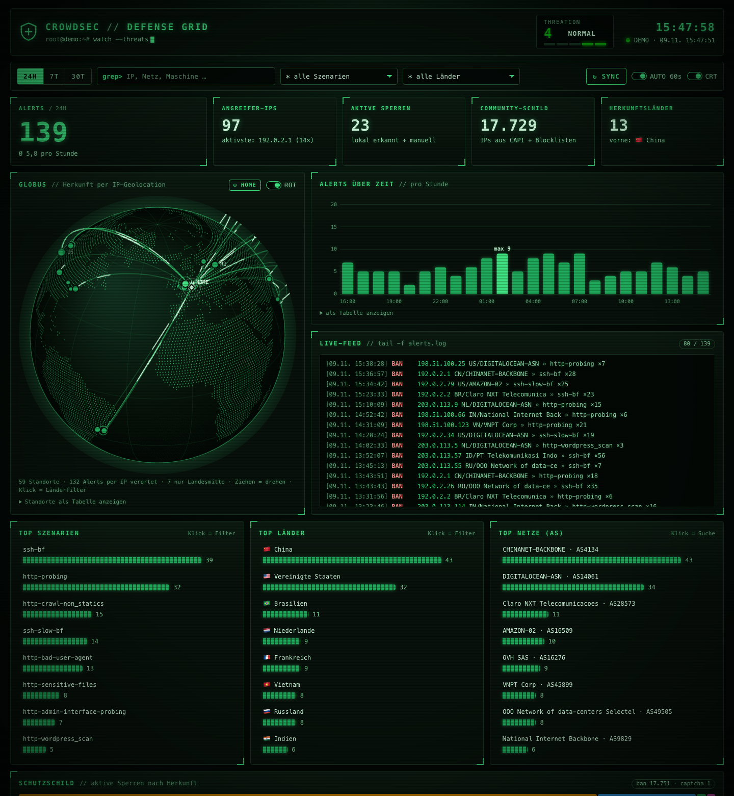

# CrowdSec Defense Grid

Ein selbst gehostetes Live-Dashboard für [CrowdSec](https://www.crowdsec.net/) im Stil eines Hacker-Terminals mit Röhrenmonitor-Optik: Phosphorgrün, Scanlines, Boot-Sequenz und ein drehbarer 3D-Globus mit Angriffsbögen. Der Fokus bleibt auf lesbaren Zahlen und schnellem Filtern.



## Funktionen

- **THREATCON-Anzeige**: Alerts der letzten Stunde im Vergleich zum Durchschnitt im Zeitraum (Stufe 5 = ruhig bis 1 = kritisch)
- **3D-Globus**: jede Angreifer-IP per Geolocation verortet, Bögen zum eigenen Server (`HOME_LAT`/`HOME_LON`), drehbar per Maus, Touch oder Pfeiltasten, Klick setzt den Länderfilter
- **Alerts über Zeit**: 24 h / 7 Tage / 30 Tage, mit Tooltip und Tabellenansicht
- **Live-Feed**: `tail -f`-Ansicht der neuesten Alerts; neue Einträge leuchten auf
- **Top-Szenarien, -Länder und -Netze (AS)**: Ein Klick setzt den Filter (Kreuzfilter, alle Panels reagieren)
- **Schutzschild**: aktive Sperren nach Herkunft (lokal, cscli, Community/CAPI, Blocklisten)
- **Tabellen** für Alerts und aktive lokale Sperren mit Restlaufzeit
- Tastatur: `/` Suche · Globus: Pfeiltasten drehen, `H` richtet auf den eigenen Server aus · `R` Sync · `1` `2` `3` Zeitraum · `Esc` Filter löschen
- CRT-Effekte und Globus-Rotation abschaltbar; bei `prefers-reduced-motion` gibt es keine Animationen
- Keine Abhängigkeiten: Python-Standardbibliothek plus Vanilla JS, keine CDNs, strikte CSP

## Geo-Coding der IPs

1. **CrowdSec selbst** (Standard): Die Anreicherung `crowdsecurity/geoip-enrich` schreibt aus der GeoLite2-City-Datenbank Breiten- und Längengrad in jeden Alert (`source.latitude`/`source.longitude`). Das Dashboard übernimmt diese Werte. Es fließen keine Daten nach außen.
2. **Optionaler Fallback** `GEO_FALLBACK=ipapi`: IPs ohne Koordinaten werden über `ip-api.com` nachgeschlagen (Batch, gecacht, höchstens 300 IPs pro Abruf). **Achtung:** Dabei gehen Angreifer-IPs an einen Drittanbieter, und die kostenlose Variante ist nur für nicht-kommerzielle Nutzung gedacht.
3. **Letzte Stufe**: der Mittelpunkt des Landes. Der Globus weist diese Punkte als „nur Landesmitte“ aus.

Nahe beieinanderliegende IPs (Raster von etwa 50 km, also meist dasselbe Rechenzentrum oder dieselbe Stadt) werden zu einem Punkt zusammengefasst. Die Punktgröße steht für die Zahl der Alerts. Leuchtende, pulsierende Punkte waren in der letzten Stunde aktiv. Die Bögen führen von den 45 aktivsten Standorten zum eigenen Server.

Geolocation-Daten geben den Standort des Netzes an, nicht den der Person dahinter: Bei VPNs und Cloud-Servern ist es das Rechenzentrum.

## Architektur

```
Browser ──► server.py (Proxy + Aggregation, Basic-Auth) ──► CrowdSec LAPI
             │  /api/summary?range=24h|7d|30d
             └─ static/ (HTML, CSS, JS)
```

Der Browser spricht nie direkt mit der LAPI. Die Zugangsdaten bleiben auf dem Server.

- **Alerts** kommen über `GET /v1/alerts` mit einem eigenen Maschinen-Login (Watcher, JWT).
- **Aktive Sperren** kommen über `GET /v1/decisions` mit einem Bouncer-API-Key. Community- und Blocklisten-Sperren werden nur gezählt, nicht einzeln übertragen.

## Schnellstart (Demo ohne CrowdSec)

```bash
DEMO=1 python3 server.py
```

Dann <http://127.0.0.1:3000> öffnen. Die Demo nutzt ausschließlich IPs aus den Dokumentationsnetzen (RFC 5737).

## Einrichtung mit echter LAPI

### 1. Zugänge auf dem CrowdSec-Host anlegen

```bash
# Bouncer-Key für die aktiven Sperren (Key wird nur einmal angezeigt)
sudo cscli bouncers add crowdsec-dashboard

# Maschinen-Login für die Alerts
# WICHTIG: -f /dev/null, sonst wird /etc/crowdsec/local_api_credentials.yaml überschrieben!
sudo cscli machines add crowdsec-dashboard --password 'LANGES-ZUFALLSPASSWORT' -f /dev/null
```

Läuft CrowdSec in Docker, die Befehle mit `docker exec crowdsec cscli …` ausführen.

### 2. Konfigurieren

```bash
cp .env.example .env
chmod 600 .env
# LAPI_URL, LAPI_MACHINE_PASSWORD, LAPI_BOUNCER_KEY, DASHBOARD_PASSWORD, HOME_LAT/LON eintragen
```

| Variable | Bedeutung | Standard |
|---|---|---|
| `LAPI_URL` | Adresse der Local API | `http://127.0.0.1:8080` |
| `LAPI_MACHINE_ID` / `LAPI_MACHINE_PASSWORD` | Maschinen-Login für Alerts | – |
| `LAPI_BOUNCER_KEY` | Bouncer-Key für aktive Sperren | – |
| `LAPI_INSECURE_TLS` | Zertifikatsprüfung für HTTPS-LAPI abschalten | `false` |
| `LISTEN_HOST` / `LISTEN_PORT` | Adresse des Dashboards | `127.0.0.1` / `3000` |
| `DASHBOARD_USER` / `DASHBOARD_PASSWORD` | Basic-Auth (aktiv, sobald ein Passwort gesetzt ist) | `admin` / – |
| `HOME_LAT` / `HOME_LON` / `HOME_LABEL` | Standort des eigenen Servers auf dem Globus | Frankfurt |
| `GEO_FALLBACK` | `ipapi` = fehlende Koordinaten über ip-api.com ergänzen | aus |
| `ALERT_LIMIT` | max. Alerts pro Abruf | `5000` |
| `CACHE_TTL` | Cache in Sekunden (schont die LAPI) | `20` |
| `DEMO` | Demo-Daten statt LAPI | `false` |

Es reicht auch nur einer der beiden Zugänge: Fehlt einer, bleibt der jeweilige Bereich leer und ein Hinweis erscheint.

### 3a. Start mit Docker Compose

```bash
docker compose up -d --build
```

Standardmäßig nutzt der Container das Host-Netz (für eine LAPI auf `127.0.0.1:8080`) und lauscht nur auf `127.0.0.1:3000`. Läuft CrowdSec selbst als Container, steht die passende Variante als Kommentar in `docker-compose.yml`.

### 3b. Start ohne Docker (systemd)

```ini
# /etc/systemd/system/crowdsec-dashboard.service
[Unit]
Description=CrowdSec Defense Grid
After=network-online.target crowdsec.service

[Service]
EnvironmentFile=/opt/crowdsec-dashboard/.env
ExecStart=/usr/bin/python3 /opt/crowdsec-dashboard/server.py
DynamicUser=yes
Restart=on-failure

[Install]
WantedBy=multi-user.target
```

### 4. Von außen erreichbar machen

Das Dashboard zeigt Angreifer-IPs und die eigene Infrastruktur. Deshalb nur hinter einem Reverse-Proxy mit TLS betreiben und `DASHBOARD_PASSWORD` setzen, z. B. mit Caddy:

```
crowdsec.example.com {
    reverse_proxy 127.0.0.1:3000
}
```

## Sicherheitshinweise

- Das Dashboard liest nur. Der Maschinen-Login hätte aber Watcher-Rechte (er könnte Alerts melden). Deshalb `.env` mit `chmod 600` schützen und ein eigenes, zufälliges Passwort verwenden.
- Der Maschinen-Login erscheint in `cscli machines list`. Da er keinen Heartbeat sendet, wird er dort mit der Zeit als inaktiv angezeigt. Das ist normal.
- Alle Daten aus der LAPI werden im Browser per `textContent` ausgegeben, nie als HTML.

## Lizenz

MIT, siehe [LICENSE](LICENSE). Kein offizielles Projekt von CrowdSec.

Landmassen: [Natural Earth](https://www.naturalearthdata.com/) 1:110m (gemeinfrei) über [world-atlas](https://github.com/topojson/world-atlas), umgerechnet in ein Punktraster (`static/land.json`).
